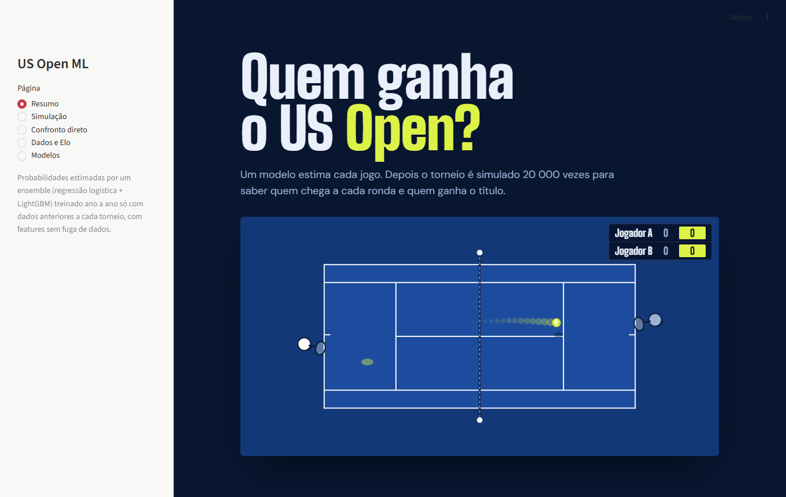
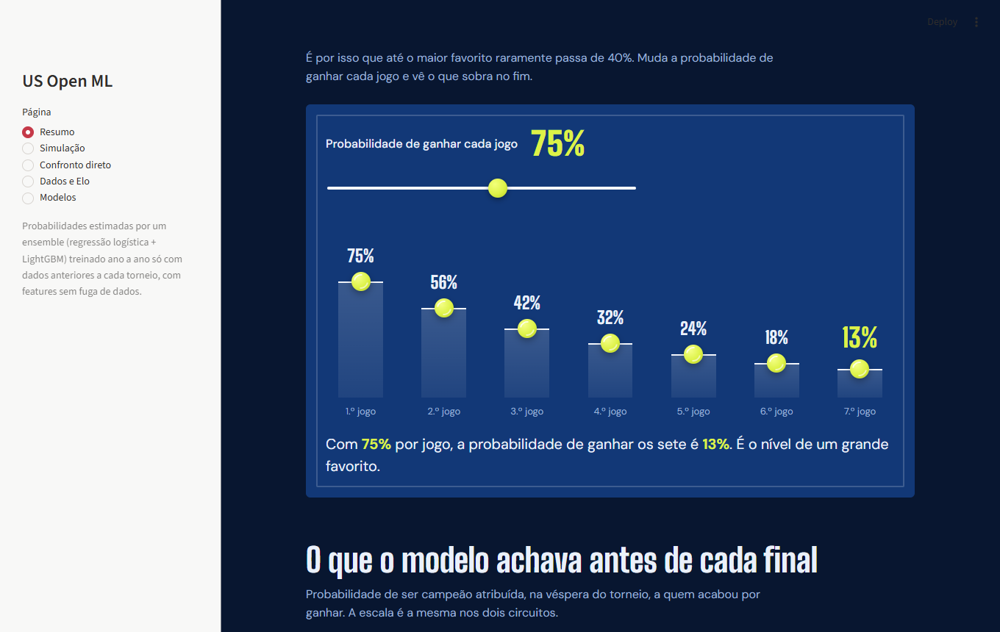
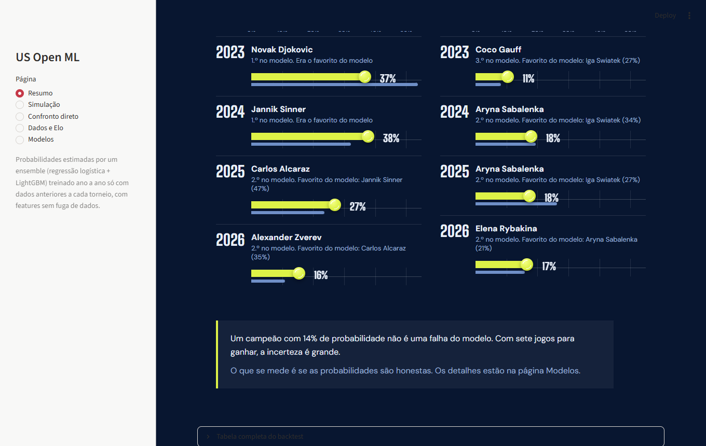
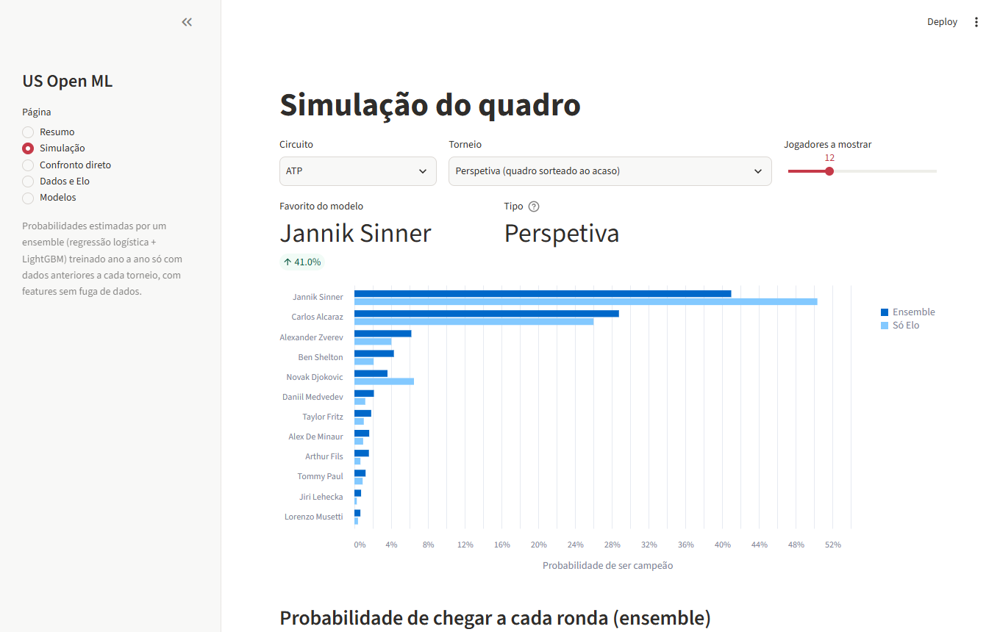
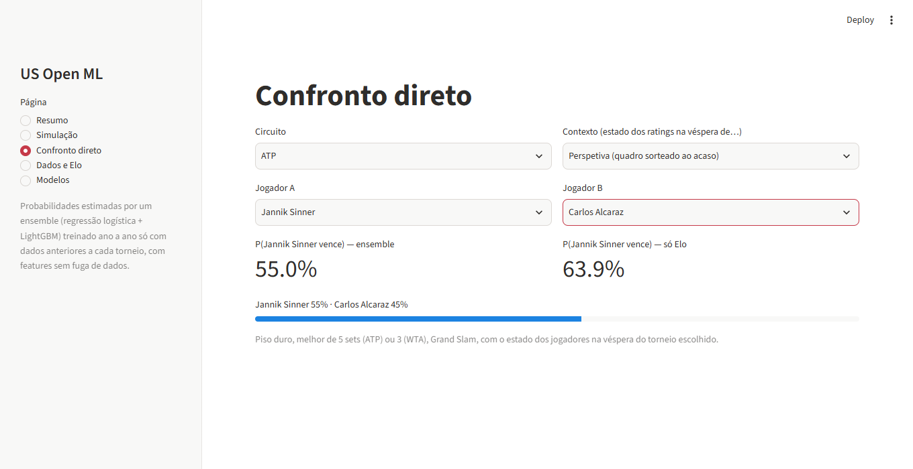

# US Open ML

[](https://github.com/nxnestsk/us-open-ml/actions/workflows/tests.yml)


Estimativa, com machine learning, das hipóteses de cada jogador no US Open (ATP e WTA).

Um modelo estima a probabilidade de cada jogo; depois o quadro é simulado 20 000 vezes (Monte Carlo) para obter a probabilidade de cada jogador chegar a cada ronda e ser campeão. O projeto foi construído como material de estudo; os resultados completos e os resultados negativos estão em [`reports/`](reports/).



<details>
<summary>Mais capturas da aplicação</summary>






</details>

## Resultados

Teste em jogos de 2023 a 2026, nunca usados para treinar nem para escolher parâmetros. Log loss (menor é melhor; 0,693 equivale a "não sei nada").

| | ATP | WTA |
|---|---|---|
| Elo sozinho | 0,6398 | 0,6253 |
| Ensemble (regressão logística + LightGBM) | 0,6110 | 0,6058 |
| Mercado de apostas (jogos após Roland Garros 2026) | 0,6166 | 0,5795 |

- O ensemble melhora o Elo de forma clara (cerca de −0,028 no ATP e −0,019 no WTA, intervalos de confiança sem o zero).
- Contra o mercado: no ATP é **estatisticamente indistinguível** (+0,007, intervalo −0,005 a +0,018); no WTA o mercado ainda é claramente melhor (+0,029).
- Nos US Open de 2023 a 2026 o campeão real esteve sempre nos 3 primeiros do modelo (nos 2 primeiros em 7 de 8) e o modelo bateu o Elo em 7 dos 8 torneios.

## Limites (importante)

- Não há dados de lesões nem de notícias. O "risco de lesão" é um indicador aproximado calculado a partir do historial de desistências, e o seu ganho **não está provado** (intervalos de confiança incluem o zero).
- Os intervalos de confiança assumem jogos independentes, o que não é exato; os ganhos pequenos (abaixo de 0,002 de log loss) devem ser lidos com cautela.
- As previsões "para o próximo US Open" usam um quadro sorteado ao acaso, sem cabeças de série, e são ilustrativas. Uma previsão a sério exige o sorteio real.
- Só foram feitos 8 backtests de torneios: resultado encorajador, não conclusivo.
- Isto não é aconselhamento de apostas e não foi demonstrado que dê lucro.

## Estrutura

```
src/        dados, Elo, features, métricas, simulação
scripts/    00 descarga · 01 Elo · 02 modelos v1 · 03 simulação · 04 afinar Elo · 05 walk-forward · run_all
app/        front end em Streamlit
tests/      testes (incluindo os que garantem que não há fuga de dados)
reports/    relatórios gerados pelos scripts
assets/     capturas de ecrã
```

## Como reproduzir

Requer Python 3.13 e git. Cerca de 170 MB em disco e cerca de 15 minutos de cálculo.

**1. Criar o ambiente**

| Windows (PowerShell) | Linux e macOS |
|---|---|
| `python -m venv .venv` | `python3 -m venv .venv` |
| `.venv\Scripts\Activate.ps1` | `source .venv/bin/activate` |

```bash
pip install -r requirements.txt
```

**2. Correr tudo com um comando** (descarrega os dados, corre os 5 scripts e os testes)

```bash
python scripts/run_all.py
```

**3. Abrir a aplicação**

```bash
streamlit run app/streamlit_app.py     # http://localhost:8501
```

Também podes correr cada passo em separado, por esta ordem: `00_download_data.py`, `01_eda_elo.py`, `02_models.py`, `04_tune_elo.py`, `05_walkforward.py`, `03_simulate.py`, e `python -m pytest -q tests`. A ordem importa: o 05 precisa dos parâmetros do 04 e dos modelos v1 do 02; o 03 precisa dos modelos do 05; a aplicação lê o que o 03 gerou.

Os ficheiros `data/processed/` (exceto um pequeno instantâneo de resultados) e `models/` não estão no repositório porque se regeneram com os scripts.

**Sem correr nada:** os resultados estão neste README e em `reports/`. A aplicação abre e as páginas Resumo, Simulação, Confronto direto e Modelos funcionam com o que está no repositório; a página "Dados e Elo" precisa que corras os scripts 00 e 01.

**Os números podem diferir ligeiramente:** o `tennis-data.co.uk` acrescenta jogos todas as semanas, por isso quem reproduzir mais tarde obtém resultados um pouco diferentes dos aqui publicados (que usam dados até 8 de novembro de 2026).

### Se a descarga dos dados falhar

- **O espelho dos dados Sackmann desapareceu** (o repositório original já desapareceu uma vez): o script tem um plano B automático e usa a [Release `data-v1`](https://github.com/nxnestsk/us-open-ml/releases/tag/data-v1) deste repositório. Podes forçá-lo com `python scripts/run_all.py --release`.
- **O `tennis-data.co.uk` devolve erro 403:** descarrega os 4 ficheiros Excel em http://www.tennis-data.co.uk/alldata.php e guarda-os em `data/raw/tennis_data_uk/` como `atp_2025.xlsx`, `atp_2026.xlsx`, `wta_2025.xlsx` e `wta_2026.xlsx`. Depois corre `python scripts/run_all.py --skip-download`.

## Dados e atribuição

Os dados originais não estão no repositório; o `scripts/00_download_data.py` descarrega-os.

- **Resultados ATP e WTA:** arquivo de **Jeff Sackmann** (Tennis Abstract), licença [CC BY-NC-SA 4.0](https://creativecommons.org/licenses/by-nc-sa/4.0/) (uso não comercial, com atribuição e partilha nas mesmas condições). O repositório original já não está disponível; usa-se um espelho comunitário (`Aneeshers/tennis-sackmann-archive`). A Release `data-v1` guarda uma cópia, sem alterações, dos ficheiros de jogos, com a mesma licença.
- **Resultados e odds de 2025 e 2026:** [tennis-data.co.uk](http://www.tennis-data.co.uk/). Estes ficheiros **não** são redistribuídos aqui.

Respeita os termos de cada fonte se reutilizares os dados.

## Licença

O código deste repositório é licenciado sob a [licença MIT](LICENSE). Os dados descarregados mantêm as licenças das respetivas fontes, descritas acima.
